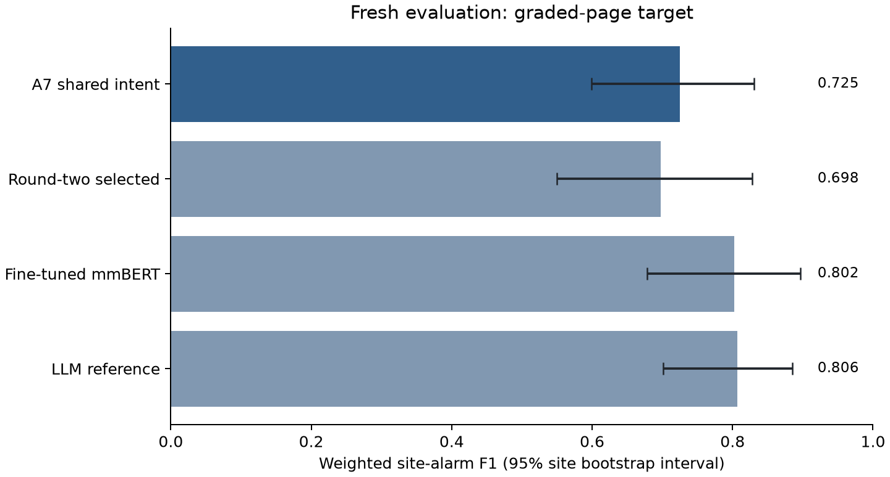

# Sensitive-niche screening: a research case study

This is personal research, code and numeric model weights shared for learning and further experimentation. It is **not production-ready**. The original cue and link lists are not included: they were derived from the crawl and part came from a GPL source. The frozen weights require compatible projected features as well as embeddings; this is not a text-to-score package.

At [Seeders](https://seeders.com/) I encountered a problem that prompted my own personal research: a crawl of hundreds of thousands of websites containing numerous pages per site, and a homepage check only could miss promotional content. An LLM per page would be expensive. I explored whether existing page embeddings and lightweight text and outbound-link features could screen for sensitive-topic promotions while separating those signals from a site operator.



On the fresh graded-page site-alarm target, the A7 commercial screen scored weighted F1 **0.725** (95% site-bootstrap interval 0.599–0.830); the LLM reference scored **0.806**. Against the same incomplete observed truth using every captured page A7 scored **0.570**; a true positive on an ungraded page can appear to be a false positive. A separate round-two operator head scored **0.721** on its operator target. These are distinct tasks. The older homepage-only result of 0.545 used a different cohort and target and is context, not a paired comparison. [Results](docs/RESULTS.md) explain the sampling and uncertainties.

## Use the research weights

Use Python 3.10+ and NumPy. Install `requirements.txt`; `huggingface-hub` is needed only for downloads. Both heads need **1,024-dimensional `text-embedding-3-small` page embeddings and compatible projected evidence**, with one row per captured page. The release does not construct the original evidence from text or links. A vector alone is insufficient.

```python
from niche_screen import load_model, score_pages, score_site

model = load_model("weights")  # or load_model() after the private HF release is accessible
pages = score_pages(model, vectors, a7_features)  # (N,1024), (N,9,19)
site = score_site(model, vectors, a7_features, operator_features, is_homepage)
# operator_features: (N,9,16), is_homepage: (N,)
```

The model returns nine topic scores, decisions, and separate commercial and operator signals. See [bring your own data](docs/BRING_YOUR_OWN.md) for feature definitions, caller-owned lists, embeddings, refitting, calibration and evaluation. Own cues and lists differ from the original inputs, so frozen results do not transfer automatically.

## Run synthetic examples

```sh
python3 -m venv .venv
. .venv/bin/activate
python -m pip install -r requirements.txt
python -m niche_screen.demo
python -m niche_screen.retrain --demo
python -m unittest discover -s tests -v
```

Both demos use fictional generated inputs; their scores say nothing about real-world accuracy. The first is an independent small trainable baseline; the second refits the research head architectures on synthetic projected arrays and evaluates held-out synthetic sites.

Read the [case study and method](docs/METHOD.md), [results and subgroup tables](docs/RESULTS.md), [experiments and ablations](docs/EXPERIMENTS.md), [anonymized examples](docs/EXAMPLES.md), [limitations](docs/LIMITATIONS.md) and [model card](MODEL_CARD.md). Numeric weights are available on [Hugging Face](https://huggingface.co/MikeCVermeer/sensitive-niche-screening) and as a [GitHub release](https://github.com/MikeCVermeer/sensitive-niche-screening/releases/tag/v1.0.0). MIT license; see [LICENSE](LICENSE).
