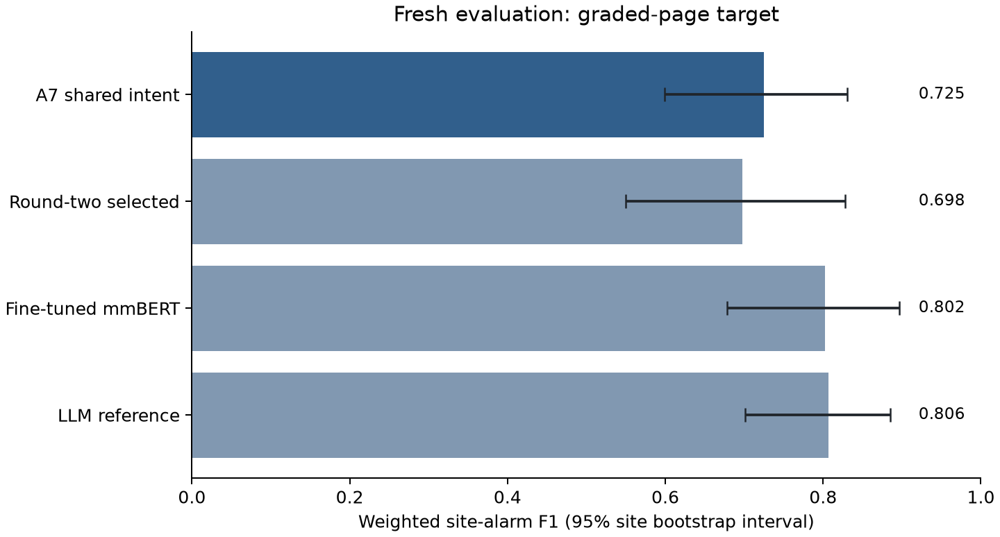
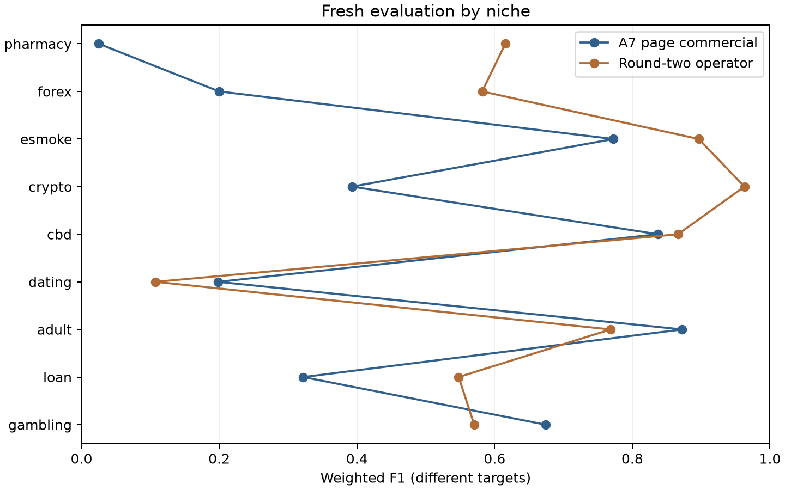

# Results

The fresh sample contained 615 sites across nine languages; the primary observed site-alarm truth was assessable for at least one niche on 544 sites. Results use inverse-inclusion weighting and 1,500 site-cluster bootstrap replicates. Site alarms refer to observed operator status or commercial evidence on assessed pages. The answer key is AI-graded and needs human spot checks.

| Candidate | Page commercial F1 | Operator F1 | Site alarm F1, graded pages | Site alarm F1, all crawl pages |
|---|---:|---:|---:|---:|
| A7 | 0.682 | 0.349 | 0.725 | 0.570 |
| Round-two selected | 0.563 | 0.721 | 0.698 | 0.607 |
| mmBERT | 0.636 | 0.597 | 0.802 | 0.676 |
| LLM reference | 0.830 | 0.623 | 0.806 | — |

For A7, the graded-page site alarm 95% interval is 0.599–0.830; the all-crawl comparison against the same incomplete observed target is 0.570 (0.472–0.668). A real positive on an ungraded page can be counted as a false positive. LLM grades were not obtained for all pages. The separate selected operator score of 0.721 has interval 0.384–0.921; excluding low-confidence positive operator grades gives 0.921 (0.675–0.987), a sensitivity analysis, not a replacement for the primary result. A7’s historical page-operator proxy was 0.349; the paired operator difference was +0.372 (0.068–0.645).

The combined A7 commercial OR round-two operator rule was examined post hoc. It added two site-topic calls across 615 sites; its all-crawl F1 was 0.569897 versus 0.569890 for A7, and needs independent confirmation.

## Fresh subgroup tables

Point estimates have wide intervals and should not be read as a ranking without their support and uncertainty. The columns are different targets: A7 commercial pages, selected round-two site operator, and selected round-two observed site alarm. Complete precision, recall, support and intervals for all candidates are in [fresh aggregate JSON](../results/fresh-aggregate.json).

### By niche

| Group | A7 page commercial F1 | Round-two operator F1 | Round-two site alarm F1 |
|---|---:|---:|---:|
| gambling | 0.674 | 0.570 | 0.722 |
| loan | 0.322 | 0.548 | 0.681 |
| adult | 0.872 | 0.768 | 0.770 |
| dating | 0.199 | 0.108 | 0.384 |
| cbd | 0.837 | 0.866 | 0.943 |
| crypto | 0.393 | 0.963 | 0.885 |
| esmoke | 0.773 | 0.897 | 0.761 |
| forex | 0.200 | 0.582 | 0.322 |
| pharmacy | 0.025 | 0.615 | 0.373 |

### By language

| Group | A7 page commercial F1 | Round-two operator F1 | Round-two site alarm F1 |
|---|---:|---:|---:|
| de | 0.803 | 0.952 | 0.731 |
| en | 0.735 | 0.846 | 0.638 |
| es | 0.441 | 0.892 | 0.755 |
| fr | 0.480 | 0.063 | 0.618 |
| it | 0.796 | 0.941 | 0.662 |
| nl | 0.839 | 0.998 | 0.990 |
| pl | 0.196 | 0.321 | 0.421 |
| pt | 0.309 | 0.830 | 0.575 |
| sv | 0.712 | 0.345 | 0.915 |

## Earlier test, costs and coverage

Round one had 1,200 packets from 149 sites, of which 1,145 were assessable. Weighted capture availability was 95.2%. A7's page alarm F1 was 0.736 (0.564–0.850), and max-over-graded-pages site alarm F1 was 0.780 (0.679–0.861). The round-one A4 development choice and the older homepage-only baseline used different selection rules or targets. See [experiments](EXPERIMENTS.md) and [round-one aggregate JSON](../results/round1-aggregate.json).

Round-one and round-two metered OpenAI research spend was roughly $2.88 and $3.86, respectively: approximately $7 total, excluding compute, crawling and other costs. The round-one teacher rate was $0.123 per 1,000 page packets. Multiplying that observed rate by approximately four million pages gives about $490 per run; the exact crawl count and packet sizes change this estimate. With existing compatible vectors the trained heads add $0 per-page API spend; this does not make crawling, embedding generation or infrastructure free.

Rare-niche enrichment created unequal weights: five sites contributed 45.4% of estimated commercial-page positives and five 65.8% of estimated operator positives. Adult operator, French and Polish results in particular need further review. New real sponsored posts and independently human-reviewed negatives are a priority.
